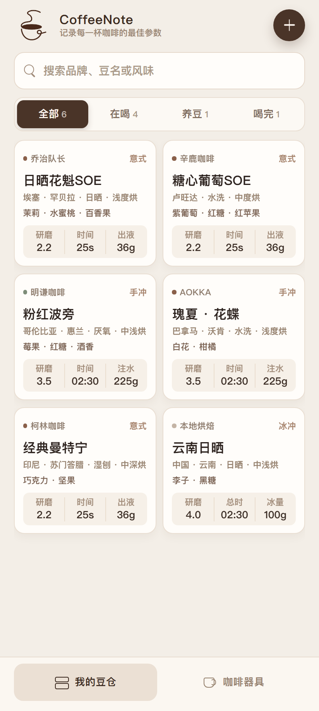
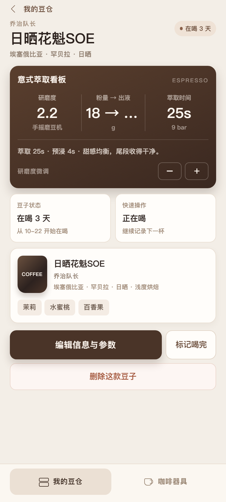
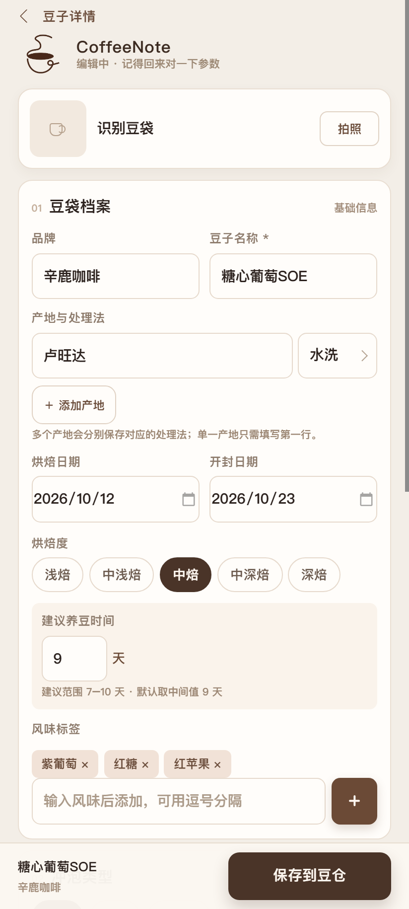
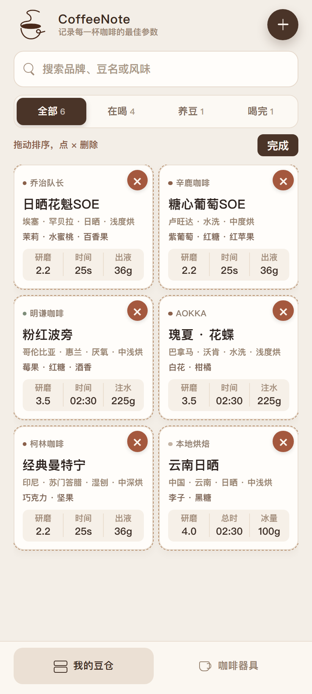
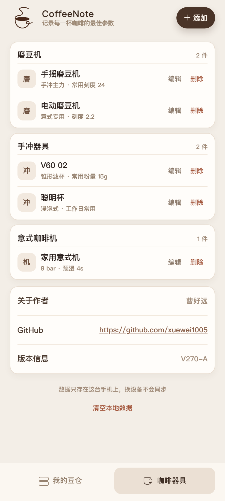
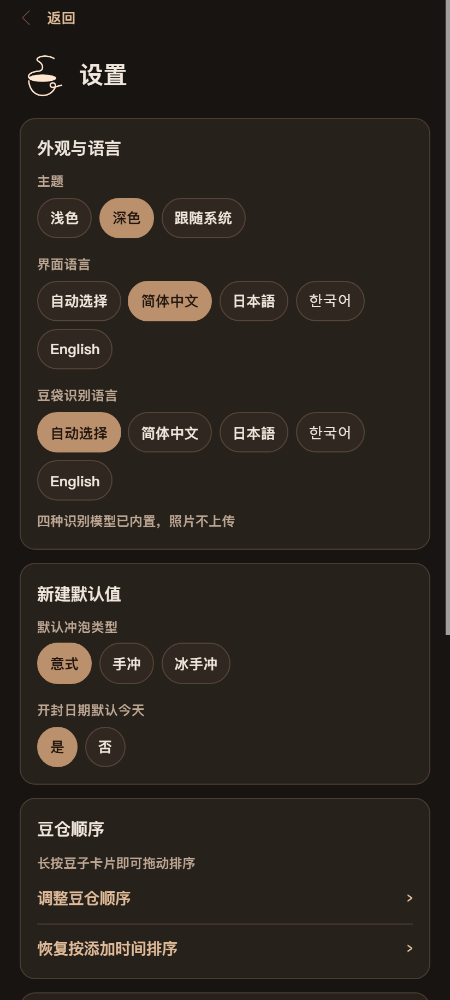
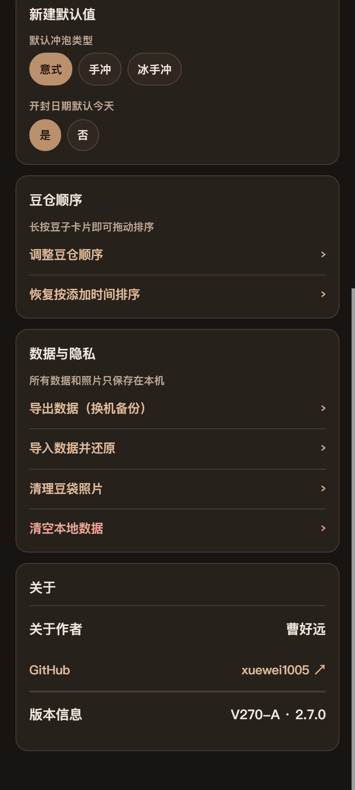
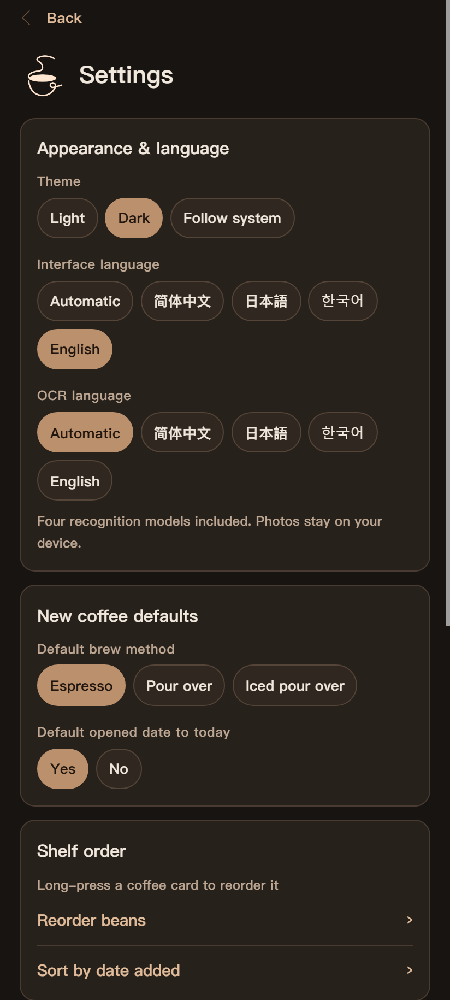
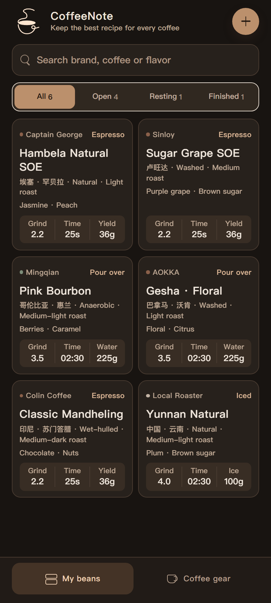

# CoffeeNote · Coffee Tasting Notes

Keep the best recipe for every coffee.  /  记录每一杯咖啡的最佳参数。

**[简体中文 / Chinese](README.md)** · **[Download APK / 下载 APK](https://github.com/xuewei1005/CoffeeNote/releases/latest)** · **[Changelog / 更新日志](CHANGELOG.md)**

CoffeeNote is an Android coffee journal for home brewers. Keep coffee beans, flavor notes, resting status, brewing recipes and gear together.
CoffeeNote 是面向家庭咖啡爱好者的 Android 咖啡记录工具，集中管理咖啡豆、风味、养豆状态、冲煮配方和器具。

No account is required. Records, photos, gear and preferences stay on the device, and coffee-bag text recognition runs locally.
无需账号；记录、照片、器具和偏好保存在本机，豆袋文字识别也在本地运行。

> This repository distributes APK releases, a promotional video, bilingual documentation and example screenshots only. The application source code is not published and no open-source license is granted.
> 本仓库只发布 APK、宣传视频、双语文档和示例截图，不提供 App 源代码，也不授予开源许可。

## Download and install / 下载安装

- Current version / 最新版本: **2.8.0**
- Requires / 系统要求: **Android 8.0 or later**
- Release APK / 正式版: [CoffeeNote-2.8.0-release.apk](https://github.com/xuewei1005/CoffeeNote/releases/download/v2.8.0/CoffeeNote-2.8.0-release.apk)
- Install over the previous version without uninstalling or clearing data. / 更新时直接覆盖旧版，不要卸载或清除数据。
- SHA-256: `65A4B9CDC67732B83C24F191AD4ECFE648821308D982DC5B9198C289EF51FD3A`

## Features / 功能

| Feature / 功能 | English | 中文 |
| --- | --- | --- |
| Coffee shelf / 我的豆仓 | Brand, name, multiple origins, processing, roast, dates and complete tasting notes. | 品牌、豆名、多产地、处理法、烘焙度、日期和完整风味。 |
| Bag OCR / 豆袋识别 | On-device recognition and field classification for Chinese, Japanese, Korean and Latin text. | 本地识别并自动归类中日韩英文字段。 |
| Brewing recipes / 冲煮配方 | Independent single-select tabs for espresso, pour-over and iced pour-over; espresso defaults to 25 seconds. | 意式、手冲、冰手冲三个固定单选标签，参数独立；意式默认 25 秒。 |
| Resting status / 养豆状态 | Automatically calculated from roast date, rest days and opened date. | 按烘焙日、养豆天数和开封日自动计算。 |
| Cards, gear and backup / 卡片、器具与备份 | Long-press to reorder or delete cards, manage gear, and export or import JSON for device transfer. | 长按排序或删除，管理器具，JSON 导出导入换机。 |
| Themes and languages / 主题与语言 | Light, dark or system theme; Chinese, Japanese, Korean and English. | 浅色、深色、跟随系统；中日韩英。 |

## Promotional video / 软件宣传片

The player below plays the promo video directly. / 下方播放器可以直接播放宣传片。

<video controls playsinline preload="metadata" width="360" poster="screenshots/09-shelf-dark-en.png" src="https://github.com/user-attachments/assets/098862b7-bd0b-46f5-b9de-311dd7f1b347">CoffeeNote 2.8.0 promo video / CoffeeNote 2.8.0 宣传片</video>

[备用播放 / Open video](https://github.com/user-attachments/assets/098862b7-bd0b-46f5-b9de-311dd7f1b347) · [Download / 下载](https://github.com/xuewei1005/CoffeeNote/releases/download/v2.8.0/CoffeeNote-2.8.0-promo-vertical-1080x1920.mp4)

## Screenshots / 功能截图

All nine previous screenshots are kept and displayed below. / 以下 9 张历史截图全部保留并直接显示。

| Shelf / 豆仓 | Bag OCR / 豆袋识别 | Recipe / 冲煮配方 |
| --- | --- | --- |
|  |  |  |

| Reorder and delete / 排序删除 | Coffee gear / 咖啡器具 | Dark settings / 深色设置 |
| --- | --- | --- |
|  |  |  |

| Backup and privacy / 备份隐私 | English settings | English shelf |
| --- | --- | --- |
|  |  |  |

## Author / 作者

**曹好远 (Cao Haoyuan)** · GitHub: [@xuewei1005](https://github.com/xuewei1005)

Feedback / 问题反馈: please open an Issue in this repository. / 请在本仓库提交 Issue。
